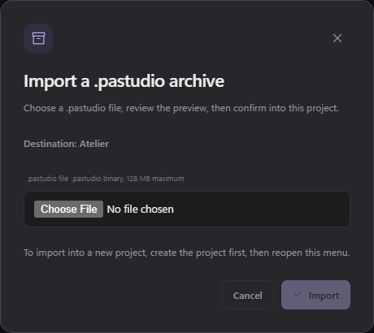

# Projects and conversations

**English** · [Français](../navigation.md) · [← Back to README](../../README.md)

Since version 3.0.0, conversations appear directly beneath their collapsible project in the sidebar, with pinned projects grouped at the top.

## Open and collapse

- The chevron to the left of a project expands or collapses its conversations. It works with **Enter** or **Space** on the keyboard. This keeps the active conversation, its draft and running agents unchanged.
- On desktop, the project name opens its overview. On phones, it expands or collapses its conversations while keeping the sidebar open, just like the chevron. Tap a conversation title to open it; the sidebar then closes to make room for it.
- An expanded project initially shows five conversations, with pinned sessions first, followed by the most recent ones. **Show more** adds five. **Show less** returns to the first page. The selected conversation stays visible even when it is older.
- Expanded and collapsed projects are remembered in this browser. Opening a conversation from another view expands its project.

## Persistent goals

When a conversation has a native goal, the **Goal** button in its header shows status and usage. **Edit objective** keeps the counters. **Stop goal** pauses it and stops the current run after the engine confirms the change. **Clear goal** removes the goal while preserving conversation messages. If a goal ends in **Error**, **Retry goal** starts one visible run of `/goal resume` on that same saved session without resetting its identity or usage. Retry is explicit; an error never starts an automatic retry loop. If another client changed the goal, reload it before retrying.

**Resume goal** also continues a paused goal, or a budget-limited goal whose original budget still has room. It never increases the budget or resets usage. While the current run is active, stopping, or being admitted, the dialog explains why Resume is unavailable. Opening the dialog refreshes its state before enabling actions; after Stop finishes, Resume becomes available. A failed refresh offers Reload instead of acting on stale state.

Editing appears when the connected engine advertises `goal_objective_edit`; stopping and clearing require `goal_lifecycle_control`. Resume and Retry additionally require the `goal_error_resume` capability. With no engine connection, or with an older engine, the goal remains read-only. Consultation mode also hides mutations.

## Switch quickly with Alt

Hold **Alt** to show the radial switcher above the workspace, including open dialogs. It contains up to six non-archived conversations, chosen by their latest activity across all projects, then sorted alphabetically by title. Project names appear in bold with their assigned color.

The menu uses the same live indicators as the sidebar: green for a running agent, blue for an unread response and a question mark for a pending question.

Move the pointer onto a segment, or press **1–6 on the numpad**, then release **Alt** to open the selected conversation. The number row also works. Returning to the center or pressing **Escape** cancels. Releasing Alt without a selection does nothing. Losing window focus cancels the menu; **Alt+Tab**, **Alt+F4** and **AltGr** keep their usual behavior. Switching uses normal conversation navigation and preserves drafts and running agents.

## Search and find an archive

Search at the top of the sidebar filters conversation titles, project names and their paths. Projects with results expand during search; clearing the text restores their usual presentation. The archive icon beside **Workspace** shows archived conversations, still grouped by project.

A green dot indicates an active run. A blue dot indicates an unread completed response. These indicators appear on the project and its conversation; green takes priority. Read state is shared across devices.

## Organize projects

Drag a project's name with the mouse to change its position. On touchscreens, use the handle beside the **⋯** menu. The rest of the list remains available for scrolling. With the keyboard, move the handle using **Arrow Up** and **Arrow Down**; **Escape** cancels a drag in progress.

The order is saved on the server and shared across devices. Each project stays in its pinned or unpinned group. Reordering is suspended during search, in archives and in read-only remote access.

The project’s **⋯** menu, also available through right-click, opens [project knowledge](knowledge.md). Editing actions are hidden in read-only remote access.

Each conversation also has a **⋯** menu to rename, pin or unpin it, archive or restore it, and export it as Markdown. On desktop, right-click its row to open the same menu. This menu is hidden in read-only remote access.

Use **Mark as unread** in this menu to mark the last completed response unread on all devices. If the conversation is open, Studio returns to its project overview and saves its draft so it does not immediately become read again. Opening the conversation again marks the visible response read. Empty conversations are unchanged.

Project colors also tint project pins and idle pinned conversations. Existing pastel assignments automatically use the matching vivid swatch. Uncolored projects remain neutral; running, unread and question indicators keep their existing priority.

## Import and export conversations (.pastudio)

The `.pastudio` format (v1) transfers complete conversations into another existing project. The archive can be transferred to another PC. Export and import are available on the host PC and from an authenticated remote browser with full control (LAN/Tailscale/PWA), but not in consultation mode.

- Transferred content: complete conversations with their subagents, plus the project Roadmap. Project files, settings, provider keys, memories and the engine are never included.
- Additive import: imported conversations join the target project without deleting anything. Reimporting the same archive is detected and skipped; if the source changed since, new copies are created, never merged.
- When resuming an imported conversation, no manual pick is needed: the source model is reused when configured and available on the destination, otherwise the configured destination default is used (never an old unavailable provider). History keeps the original model records without changing the effective settings. If no usable model is configured, an explicit pick is requested before running.
- Imported conversations arrive already read (no blue dot); the “Imported” badge clears on first open or after 3 minutes, on all devices. No yellow banner blocks resuming.
- Histories may contain secrets (pasted keys, tool output): review the content before sharing an archive.
- External paths quoted in a history are preserved as-is as a record; only new runs use the destination project folder.
- No running process is migrated: only histories are transferred.
- An interrupted import stays pending: preview it and retry without reinstalling anything.
- Archive limit: 128 MB compressed matched on server and UI (256 MB total uncompressed, 128 MB per entry); an archive over 64 MB needs 3.4.1 on both sides.

## Git worktrees

A **Git worktree** provides a dedicated checkout and branch attached to the project repository. The normal mode still works in the project directory. Isolation is an explicit choice, not a change to existing conversations.

### Create and work

In the project, open **New worktree**, choose **Worktree** mode, and enter a name. The conversation stays under the original project. The agent and file explorer use the worktree directory. The **Kept worktrees** list lets you reopen a worktree, even if no conversation has started there yet.

The project must be a Git repository with at least one commit and an active branch. The isolated directory starts from the current commit. Uncommitted project changes stay in the original directory; they are not copied, stashed, or deleted.

The branch and effective path identify where the agent works. Its subagents share this directory by default. Dependencies, ignored files, and local secrets are not copied automatically. Prepare the environment if needed before running tests.

### Diff and merge

The diff view shows files and a bounded diff. Untracked files are listed by name, without automatically reading their contents. Oversized output is marked as truncated.

Merging requires confirmation. In this first version, task changes must be committed, the target directory must be clean, and its branch must allow a **fast-forward**. A changed target, diverged branch, or active agent blocks a direct merge. **Prepare merge with agent** lets you ask the agent to prepare commits, resolve conflicts in the isolated directory, and rerun checks. The original directory stays unchanged during preparation; the final merge still requires your confirmation. The agent asks for a decision when a conflict affects the intended behavior. No global commit, push, stash, or reset happens automatically.

### Keep or remove

You can keep the directory to resume the task later. Removing a managed worktree requires additional confirmation if it contains unmerged or uncommitted work. The Git branch is retained; discarded uncommitted changes are not backed up by that branch.

Management actions are available on the PC and from authenticated remote devices with full control, but not in consultation mode. A worktree is **not a sandbox**: processes, ports, databases, and external services remain shared. Projects using executable Git filters are not supported in this V1.

## Images and attachments

Two separate buttons accompany the input: **Photo** opens the phone or PC image picker; **Attachment** accepts any file type. You can also **drag and drop** files into the conversation, or **paste** images and documents provided to the browser by the clipboard. Normal text pasting remains available.

Previews let you remove an attachment before sending. Draft attachments stay in this browser after a reload. Send them on their own, with instructions, as **Steer** or as **Follow up**. In a conversation, click an image to enlarge it or a file to download it.

**PNG, JPEG, GIF and WebP** images are sent to the engine with their pixels; choose an image-capable model. Other files are stored on the PC, and their paths are passed to Prime Agent for its tools. Other image formats can be attached as files.

| Per message | Maximum count | Size per attachment | Combined size |
| ----------- | ------------- | ------------------- | ------------- |
| Images      | 4             | 4 MB                | 8 MB          |
| Files       | 8             | 10 MB               | 20 MB         |

You can combine images and files, up to **8 attachments in total**. These features also work on phones over Wi-Fi or Tailscale. Sent files are stored on the PC; drafts belong to the browser in which you prepare them.
