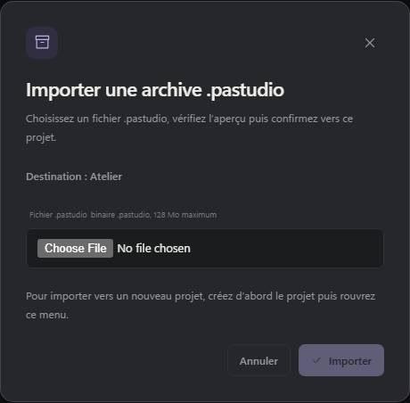

# Projets et conversations

[English](en/navigation.md) · **Français** · [← Retour au README](../README.fr.md)

Depuis la version 3.0.0, les conversations apparaissent directement sous leur projet dépliable dans la barre latérale, avec les projets épinglés regroupés en tête.

## Ouvrir et replier

- Le chevron à gauche du projet déplie ou replie ses conversations. Il est utilisable au clavier avec **Entrée** ou **Espace**. Ce geste conserve la conversation active, son brouillon et les agents en cours.
- Sur ordinateur, le nom du projet ouvre sa vue d’ensemble. Sur téléphone, il déplie ou replie ses conversations en gardant le volet ouvert, comme le chevron. Une conversation s’ouvre en touchant son titre ; le volet se referme alors pour lui laisser la place.
- Un projet déplié affiche d’abord cinq conversations, avec les sessions épinglées en premier puis les plus récentes. **Afficher plus** en ajoute cinq. **Afficher moins** revient à la première page. La conversation sélectionnée reste visible même si elle est plus ancienne.
- Le choix des projets ouverts ou repliés est enregistré dans ce navigateur. Ouvrir une conversation depuis une autre vue déplie son projet.

## Objectifs persistants

Quand une conversation possède un objectif natif, le bouton **Objectif** dans l’en-tête affiche son état et sa consommation. **Modifier l’objectif** conserve les compteurs. **Arrêter l’objectif** le met en pause et arrête l’exécution en cours après confirmation du moteur. **Effacer l’objectif** retire l’objectif, mais conserve les messages de la conversation. En état **Erreur**, **Réessayer l’objectif** lance une seule exécution visible de `/goal resume` dans la même conversation, sans réinitialiser l’identité ni les compteurs. La reprise demande une action explicite. Une modification simultanée demande de recharger l’objectif avant de réessayer.

**Reprendre l’objectif** permet aussi de continuer un objectif en pause, ou limité par le budget si son budget initial n’est pas épuisé. Cette action n’augmente jamais le budget et ne remet pas les compteurs à zéro. Si une exécution est active, en cours d’arrêt ou d’admission, la fenêtre explique pourquoi la reprise est indisponible. Son ouverture actualise l’état avant d’activer les commandes ; après la fin de l’arrêt, la reprise devient disponible. Un échec d’actualisation propose de recharger plutôt que d’agir sur un état périmé.

La modification apparaît si le moteur connecté annonce `goal_objective_edit` ; l’arrêt et l’effacement demandent `goal_lifecycle_control`. Reprendre ou réessayer exige aussi `goal_error_resume`. En l’absence de connexion au moteur ou avec un moteur plus ancien, l’objectif reste consultable sans commande incompatible. En mode consultation, aucune modification n’est disponible.

## Naviguer rapidement avec Alt

Maintenez **Alt** pour afficher le menu radial au-dessus de l’espace de travail, y compris des fenêtres de dialogue ouvertes. Il contient jusqu’à six conversations non archivées, choisies selon leur dernière activité tous projets confondus, puis triées par titre. Les noms des projets apparaissent en gras avec leur couleur.

Le menu utilise les mêmes indicateurs en direct que la barre latérale : vert pour un agent en cours, bleu pour une réponse non lue et un point d’interrogation pour une question en attente.

Survolez une portion ou appuyez sur **1 à 6 au pavé numérique**, puis relâchez **Alt** pour ouvrir la conversation sélectionnée. La rangée de chiffres fonctionne aussi. Revenir au centre ou appuyer sur **Échap** annule. Relâcher Alt sans sélection ne fait rien. Quitter la fenêtre annule le menu ; **Alt+Tab**, **Alt+F4** et **AltGr** gardent leur comportement habituel. Le changement utilise la navigation normale et conserve les brouillons et les agents en cours.

## Rechercher et retrouver une archive

La recherche en haut de la barre filtre les titres de conversation, les noms de projet et leurs chemins. Les projets contenant des résultats se déplient pendant la recherche ; effacer le texte rétablit leur présentation habituelle. L’icône d’archive à côté du titre **Espace de travail** affiche les conversations archivées, toujours regroupées par projet.

Le point vert signale une exécution en cours. Le point bleu signale une réponse terminée non lue. Ces indicateurs apparaissent sur le projet et sur la conversation concernée ; le vert est prioritaire. L’état de lecture est partagé entre appareils.

## Organiser les projets

Glissez le nom du projet à la souris pour changer sa position. Sur écran tactile, utilisez la poignée près du menu **⋯**. Le défilement reste disponible sur le reste de la liste. Au clavier, la poignée se déplace avec **Flèche haut** et **Flèche bas** ; **Échap** annule un glissement en cours.

L’ordre est enregistré sur le serveur et partagé entre appareils. Chaque projet reste dans son groupe épinglé ou non épinglé. La réorganisation est suspendue pendant une recherche, dans les archives et en accès distant en consultation.

Le menu **⋯** du projet, également accessible par clic droit, donne accès aux [connaissances du projet](knowledge.md). Les actions de modification sont masquées en accès distant en consultation.

Chaque conversation dispose aussi d’un menu **⋯** pour la renommer, l’épingler ou la désépingler, l’archiver ou la restaurer et l’exporter en Markdown. Sur ordinateur, un clic droit sur sa ligne ouvre ce même menu. Ce menu est masqué en accès distant en consultation.

Utilisez **Marquer comme non lu** dans ce menu pour marquer la dernière réponse terminée non lue sur tous les appareils. Si la conversation est ouverte, Studio revient à la vue d’ensemble du projet et conserve son brouillon pour éviter une relecture immédiate. Rouvrir la conversation marque la réponse visible comme lue. Les conversations vides ne changent pas.

Les couleurs des projets teintent aussi leurs épingles et celles des conversations épinglées inactives. Les anciennes couleurs pastel utilisent automatiquement la nuance vive correspondante. Les projets sans couleur restent neutres ; les indicateurs d’exécution, de réponse non lue et de question gardent leur priorité.

## Importer et exporter des conversations (.pastudio)

Le format `.pastudio` (v1) transfère des conversations complètes vers un autre projet existant. L’archive peut être transférée sur un autre PC. L’export et l’import sont disponibles sur le PC hôte et depuis un navigateur distant authentifié en contrôle complet (LAN/Tailscale/PWA), mais pas en mode consultation.

- Contenu transféré : conversations complètes avec leurs sous-agents, ainsi que la Roadmap du projet. Les fichiers du projet, les réglages, les clés des fournisseurs, les mémoires et le moteur ne sont jamais inclus.
- Import additif : les conversations importées s'ajoutent au projet cible sans rien effacer. Réimporter la même archive est détecté et ignoré ; si la source a changé depuis, de nouvelles copies sont créées, jamais de fusion.
- À la reprise d'une conversation importée, aucun choix manuel n'est requis : le modèle d'origine est repris s'il est configuré et disponible sur la destination, sinon le modèle par défaut configuré de la destination est utilisé (jamais un ancien fournisseur indisponible). L'historique conserve la trace des modèles d'origine sans modifier les réglages effectifs. Si aucun modèle utilisable n'est configuré, un choix explicite est demandé avant l'exécution.
- Les conversations importées arrivent déjà lues (pas de point bleu) ; le badge « Importée » disparaît à la première ouverture ou après 3 minutes, sur tous les appareils. Aucune bannière jaune ne bloque la reprise.
- Les historiques peuvent contenir des secrets (clés collées, sorties d'outils) : vérifiez le contenu avant de partager une archive.
- Les chemins externes cités dans un historique sont conservés tels quels comme témoignage ; seules les nouvelles exécutions utilisent le dossier du projet de destination.
- Aucun processus en cours n'est migré : seuls les historiques sont transférés.
- Un import interrompu reste en attente : prévisualisez-le et relancez-le sans rien réinstaller.
- Limite d’archive : 128 Mio compressés assortis côté serveur et interface (256 Mio non compressés au total, 128 Mio par entrée) ; une archive de plus de 64 Mio demande la version 3.4.1 des deux côtés.

## Worktrees Git

Un **worktree Git** fournit un checkout et une branche dédiés, rattachés au dépôt du projet. Le mode habituel continue à travailler dans le dossier du projet. L’isolation est un choix explicite, pas un changement des conversations existantes.

### Créer et travailler

Dans le projet, ouvrez **Nouveau worktree**, choisissez le mode **Worktree** et donnez-lui un nom. La conversation reste rattachée au projet d’origine. L’agent et l’explorateur de fichiers utilisent le dossier du worktree. La liste **Worktrees conservés** permet de reprendre un worktree, même si aucune conversation n’y a encore démarré.

Le projet doit être un dépôt Git avec au moins un commit et une branche active. Le dossier isolé démarre depuis le commit courant. Les modifications non commitées du projet restent dans le dossier d’origine ; elles ne sont ni copiées, ni remisées, ni supprimées.

La branche et le chemin effectif permettent de vérifier où l’agent travaille. Ses sous-agents partagent ce dossier par défaut. Les dépendances, fichiers ignorés et secrets locaux ne sont pas copiés automatiquement. Préparez l’environnement si nécessaire avant de lancer les tests.

### Diff et merge

La vue du diff présente les fichiers et un diff borné. Les fichiers non suivis sont signalés par leur nom, sans lecture automatique de leur contenu. Une sortie trop volumineuse est indiquée comme tronquée.

Le merge demande une confirmation. Pour cette première version, les changements de la tâche doivent être commités, le dossier cible doit être propre et sa branche doit permettre une avance rapide (**fast-forward**). Une cible modifiée, une branche divergente ou un agent actif bloque le merge direct. **Préparer le merge avec l’agent** permet de demander à l’agent de préparer les commits, résoudre les conflits dans le dossier isolé et relancer les contrôles. Le dossier principal reste inchangé pendant cette préparation ; le merge final exige toujours votre confirmation. L’agent vous demande un choix si le conflit porte sur le comportement souhaité. Aucun commit global, push, stash ou reset n’est effectué automatiquement.

### Conserver ou supprimer

Vous pouvez conserver le dossier pour reprendre la tâche plus tard. La suppression d’un worktree géré demande une confirmation supplémentaire s’il contient du travail non mergé ou non commité. La branche Git est conservée ; les modifications non commitées supprimées ne sont pas sauvegardées par cette branche.

Les actions de gestion sont disponibles sur le PC et depuis un appareil distant authentifié en contrôle complet, mais pas en mode consultation. Un worktree n’est **pas une sandbox** : les processus, ports, bases de données et services externes restent partagés. Les projets utilisant des filtres Git exécutables ne sont pas pris en charge par cette V1.

## Images et pièces jointes

Deux boutons distincts accompagnent le champ de saisie : **Photo** ouvre le sélecteur d’images du téléphone ou du PC ; **Pièce jointe** accepte tout type de fichier. Vous pouvez aussi **glisser-déposer** les fichiers dans la conversation, ou **coller** les images et documents que le navigateur reçoit du presse-papiers. Le collage de texte habituel reste disponible.

Les aperçus permettent de retirer une pièce avant l’envoi. Les pièces du brouillon restent dans ce navigateur après un rechargement. Vous pouvez les envoyer seules, avec une consigne, en **Réorienter** ou **À la suite**. Dans la conversation, cliquez sur une image pour l’agrandir ou sur un fichier pour le télécharger.

Les images **PNG, JPEG, GIF et WebP** sont transmises au moteur avec leurs pixels ; choisissez un modèle compatible avec les images. Les autres fichiers sont conservés sur le PC et leur chemin est transmis à Prime Agent pour ses outils. Les autres formats d’image peuvent être joints comme fichiers.

| Par message | Nombre maximal | Taille par pièce | Taille cumulée |
| ----------- | -------------- | ---------------- | -------------- |
| Images      | 4              | 4 Mo             | 8 Mo           |
| Fichiers    | 8              | 10 Mo            | 20 Mo          |

Vous pouvez combiner images et fichiers, dans la limite de **8 pièces jointes au total**. Ces fonctions sont aussi disponibles sur le téléphone, en Wi-Fi ou via Tailscale. Les fichiers envoyés sont conservés sur le PC ; les brouillons appartiennent au navigateur dans lequel vous les préparez.
